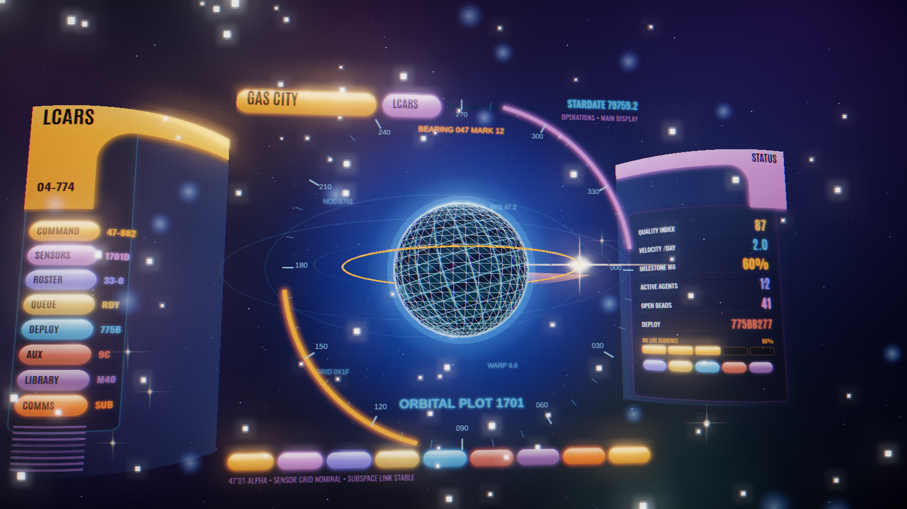
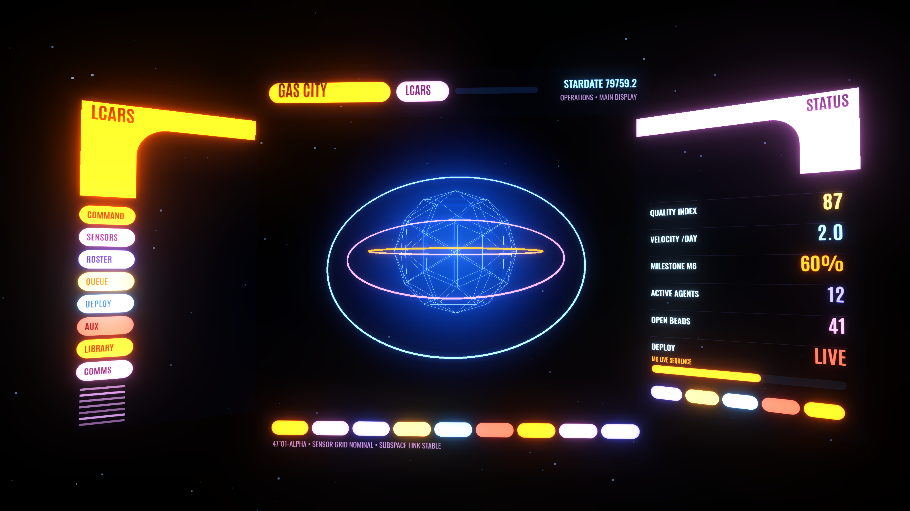
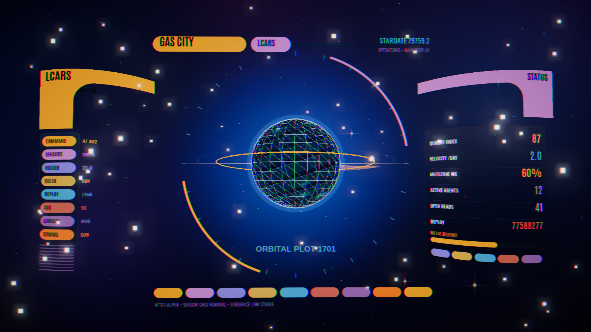
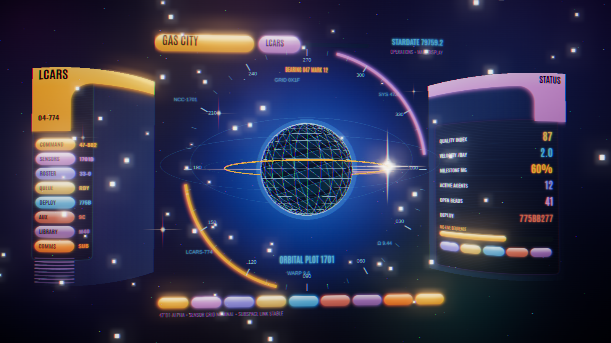

# LCARS Flight Deck — a cinematic 3D design spike

> **Status: design exploration. Do not merge.**
> This is a deliberately divergent concept, not a proposed change to the dashboard. It is the
> opposite of the house design language in [`DESIGN.md`](../../DESIGN.md) ("The Reading Room" —
> calm, light, single-typeface editorial). It lives here as a self-contained spike so the idea
> can be looked at and argued about without touching the app.

A single-file WebGL concept that renders the Gas City operator dashboard as the **establishing
computer-interface shot of a modern Star Trek series** (the Discovery / Picard / Strange New Worlds
holographic evolution of LCARS): floating translucent command consoles in deep space, a holographic
planet "viewscreen," a camera fly-in that assembles the deck, and the town's real metrics
(quality 87, velocity 2.0/day, milestone M6 60%, 12 agents, 41 open beads, deploy `775BB277`)
rendered as LCARS readouts.

**Open `index.html` in a browser** (no build step; it pulls `three@0.160.0` from the jsDelivr CDN).

## How it was built — a 5-round design/critique loop

The brief asked for the design to be produced in "a loop of 5 iterations where a reviewer criticizes
how far it is from the goal, then improvements are made." That is exactly how this was made. Each
round: build/refine the page → render the fly-in and settled frames in headless Chromium → hand the
frames (plus a fixed goal rubric, **not** the author's own opinion) to an independent reviewer that
scored *distance from the goal* 0–100 and named the top gaps as concrete, actionable requirements →
fold those into the next round. The goal rubric is in [`GOAL.md`](GOAL.md).

| Round | Score | What the reviewer drove next |
|------:|:-----:|------------------------------|
| 1 | **54** | Fix blown-out white panels; add atmosphere (nebula, fog); replace the generic "atom" hero; make a real camera move. |
| 2 | **52** | Panels still read flat — need real perspective, translucent glass, lighting hierarchy, stronger emissive bloom. |
| 3 | **60** | Make the LCARS shapes *dimensional glass* (not flat stickers); the floating arcs are orphaned; add a lens-flare finish; thicker nebula. |
| 4 | **69** | Commit *asymmetric* stage depth (near/far consoles); reskin the hero as a holographic planet; off-center low-angle resting framing; replace the empty M6 bar. |
| 5 | **78** | Close to the goal. Residual: material still slightly matte vs. a true hologram; minor legibility clip (fixed). |

The climb (54 → 52 → 60 → 69 → 78) is the point of the artifact as much as the final frame: it shows
a maker/critic loop converging on a demanding visual target with the requirements getting sharper each
round. (Round 2 dipped below round 1 — a different, harsher independent reviewer — which is exactly the
kind of variance a separate-critic loop surfaces rather than hides.)

## What's in the final design

- **LCARS DNA**: signature elbows on both consoles, stacked glossy pill buttons with numeric codes,
  the LCARS palette (amber / mauve / periwinkle / red-orange / sky / gold) on true black, condensed
  all-caps type (Antonio / Oswald), colored headers, right-aligned numeric readouts.
- **Cinematic 3D**: curved wrap-around glass consoles at different depths, a layered starfield +
  nebula + depth fog, bloom, a lens-flare glint on the orbiting satellite, a vignette and foreground
  dust-mote bokeh, and an opening camera fly-in with a staggered console assembly.
- **Holographic planet viewscreen**: a glowing lat/long grid globe with an atmosphere halo, an amber
  orbital-trace ring with animated tick markers, a rotating sensor sweep, and a bearing bezel (000–330).
- **Real dashboard content**: GAS CITY · LCARS title bar, stardate, the metric readout stack, and an
  M6 5-segment live-sequence meter.

## Implementation notes

- One file, `index.html`. `three.js` r160 (core + a few `examples/jsm` post-processing passes:
  UnrealBloom, RGBShift, Vignette, Output) via an import map from jsDelivr. Fonts from Google Fonts.
- All LCARS panels are drawn to 2D canvases and mapped onto curved planes in the 3D scene — this keeps
  the intricate vector LCARS detail crisp while giving it real depth, parallax, and bloom.
- Metrics are placeholder-but-plausible town numbers, defined in one `DATA` object near the top; wiring
  them to the live API would be the first step if this ever went beyond a spike.

## If this were ever pursued (it needn't be)

The honest read from the loop: 78/100 — unmistakably LCARS and genuinely cinematic, but a notch below
"paused from the show." Closing the gap would mean a true glass shader (emissive rim-light + internal
scanline shimmer + chromatic edge) instead of canvas-faked glass, and a richer volumetric hero. None of
that is warranted unless the concept itself is wanted — and it diverges hard from "The Reading Room,"
so the default remains: enjoy the spike, don't merge it.
